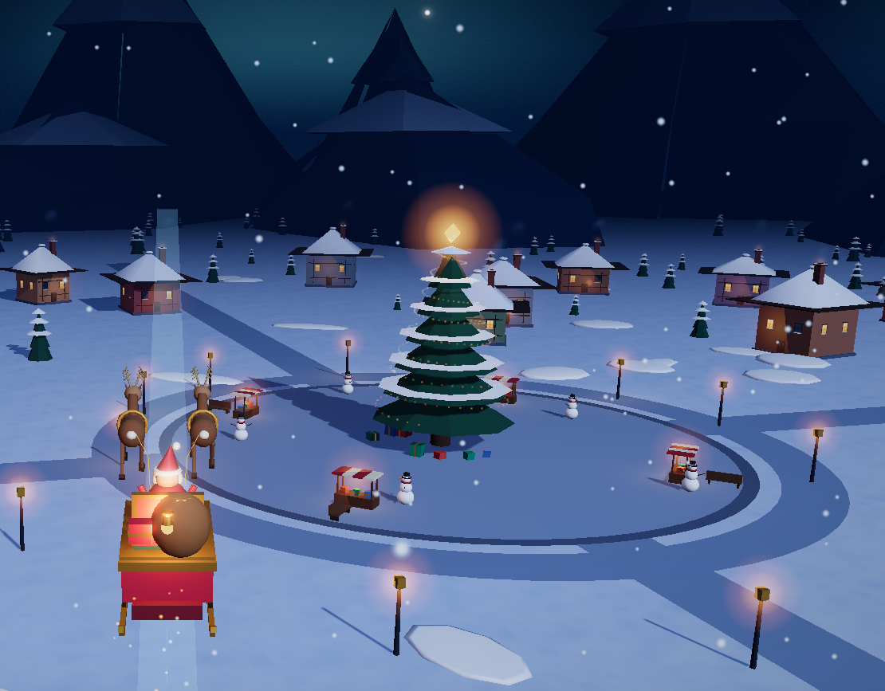

# Chimney Drop

Fly Santa's sleigh over a snowy village and drop presents straight down the
chimneys. Line up the golden aim ring, release at the right moment, and build a
streak for up to a 3× score multiplier. Miss and the streak resets. \
 \
[Play the game here](https://chimney.erikappelblad.dev)

Fly Santa's sleigh over a snowy village and drop presents straight down the
chimneys. Line up the golden aim ring, release at the right moment, and build a
streak for up to a 3× score multiplier. Miss and the streak resets.

Three levels, each with their own mood, lighting, architecture, music, and village
layout.

## Play locally

```bash
npm install
npm run dev
```

Open the local URL printed by Vite.

## Controls

- **Mouse / gamepad / touch stick** — steer
- **Click / Space / gamepad button** — drop a present
- **W / S** — climb or descend
- **A / D** — fine steering
- **R** — restart level
- **M** — mute
- **Esc** — pause

## Tech

Built with vanilla JavaScript, Three.js, and Vite. Fully procedural village,
lighting, snow, and post-processing. See
[`docs/ARCHITECTURE.md`](docs/ARCHITECTURE.md) for a codebase overview.

```bash
npm run build     # production build in dist/
npm run preview   # preview the build
```
